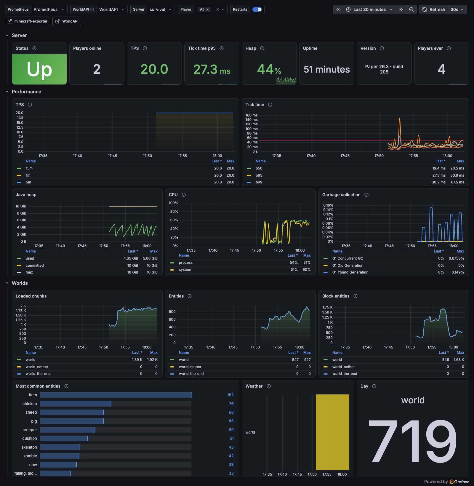

# minecraft-exporter

<p align="center">
  <a href="https://github.com/MairwunNx/minecraft-exporter/releases/latest"></a>
  <a href="https://github.com/MairwunNx/minecraft-exporter/pkgs/container/minecraft-exporter"></a>
  <a href="https://github.com/MairwunNx/minecraft-exporter/actions/workflows/ci.yml"></a>
  <a href="LICENSE"></a>
</p>

📊 **minecraft-exporter** turns your Paper server into Prometheus metrics: TPS and tick times, memory, worlds, every player's statistics, deaths, and advancements. It reads [WorldAPI](https://github.com/MairwunNx/minecraft-worldapi), so the server needs that one plugin and nothing else. Pair it with the [Grafana dashboard](https://github.com/MairwunNx/minecraft-grafana) and see the whole server on one page.

[Русская версия](README.RU.md)



## What you get

- ⏱️ **Performance:** TPS over one, five, and fifteen minutes, tick times by percentile, CPU, the Java heap, garbage collection, threads.
- 🌍 **Worlds:** loaded chunks, entities and the most common types, block entities, time of day, the day count, weather.
- 🧑‍🤝‍🧑 **Players:** who's online with ping, health, and level, when each player joined and was last seen, and lifetime statistics from the game itself: play time, deaths, kills, blocks mined, distance, diamonds, advancements, and more.
- 💀 **Activity:** joins, deaths by cause and killer, advancements by frame, first-time players, and events other plugins share through WorldAPI, like boss kills.
- 🔐 **More with a token:** the host's load, memory, and disk, the console's warnings and errors and who logged them, plugins and their versions, what crowds each world (items on the ground, villagers, the busiest chunks), where each player stands, and who chats how much.
- 🛰️ **Many servers from one exporter**, the way the blackbox exporter does it.

The exporter runs next to Prometheus, not inside the game: it asks WorldAPI on every scrape and costs the server a few HTTP requests.

## Install

You need Paper 26.3 or a fork of it with [WorldAPI](https://github.com/MairwunNx/minecraft-worldapi) 3.0 or newer. Out of the box WorldAPI lets anonymous clients read everything the exporter needs, so a token is optional.

### With Docker (recommended)

```yaml
services:
  minecraft-exporter:
    image: ghcr.io/mairwunnx/minecraft-exporter:latest
    restart: unless-stopped
    environment:
      WORLDAPI_URL: http://minecraft:8110/api/v1
```

[`examples/`](examples) holds a whole stack: the exporter, Prometheus, and Grafana with the dashboard ready. Fetch the dashboard, set `WORLDAPI_URL`, and start it; Grafana opens at `http://localhost:3000` (admin / admin):

```sh
cd examples
curl -Lo grafana/dashboards/minecraft.json https://github.com/MairwunNx/minecraft-grafana/releases/latest/download/minecraft.json
WORLDAPI_URL=http://your-server:8110/api/v1 WORLDAPI_TOKEN=… docker compose up -d
```

The token is optional; the dashboard's chat, event, and console tables need one. Read “More with a token” before you set it.

### As a binary

Download the build for your system from the [latest release](https://github.com/MairwunNx/minecraft-exporter/releases/latest) and start it:

```sh
WORLDAPI_URL=http://localhost:8110/api/v1 ./minecraft-exporter
```

Metrics appear at `http://localhost:10059/metrics`.

## Prometheus

```yaml
scrape_configs:
  - job_name: minecraft
    static_configs:
      - targets: ["minecraft-exporter:10059"]
        labels: { instance: survival }
```

The `instance` label names the server on the dashboard. A 15-second interval suits it.

### Many servers

List the servers in a YAML file and point `EXPORTER_TARGETS` at it:

```yaml
targets:
  survival:
    url: http://survival:8110/api/v1
    token_file: /run/secrets/survival   # or token: …, or nothing for anonymous reads
  creative:
    url: http://creative:8110/api/v1
    players: false                      # overrides EXPORTER_PLAYERS for this server
```

Then Prometheus asks for each one by name:

```yaml
scrape_configs:
  - job_name: minecraft
    metrics_path: /probe
    static_configs:
      - targets: [survival, creative]
    relabel_configs:
      - { source_labels: [__address__], target_label: __param_target }
      - { source_labels: [__param_target], target_label: instance }
      - { target_label: __address__, replacement: "minecraft-exporter:10059" }
```

## Settings

Each setting is an environment variable or a flag.

| Variable | Flag | Default | What it does |
|---|---|---|---|
| `WORLDAPI_URL` | `--worldapi.url` | | The WorldAPI behind `/metrics`, ending in `/api/v1` |
| `WORLDAPI_TOKEN` | `--worldapi.token` | | A WorldAPI token; without one the exporter reads as a visitor |
| `WORLDAPI_TOKEN_FILE` | `--worldapi.token-file` | | A file that holds the token, for Docker secrets |
| `EXPORTER_TARGETS` | `--targets` | | The servers behind `/probe?target=<name>` |
| `EXPORTER_PLAYERS` | `--players` | `true` | Per-player metrics with a `player` label. `false` adds every player up into one series and drops the online players' details |
| `EXPORTER_STATS_INTERVAL` | `--stats-interval` | `60s` | How often each player statistic is read again |
| `EXPORTER_TIMEOUT` | `--timeout` | `10s` | The longest a scrape may take |
| `EXPORTER_LISTEN` | `--listen` | `:10059` | Where to serve metrics |

## More with a token

Without a token the exporter reads what WorldAPI shows to every visitor. A token opens more, permission by permission:

| Permission | What it adds |
|---|---|
| `server:read` | Plugins and their versions, and what crowds each world: items on the ground, villagers, pets, named mobs, the busiest chunks with their hoppers |
| `players:private` | Where each online player stands |
| `chat:read` | Chat messages, in all and per player |
| `system:read` | The host: load, memory, swap, the disk under the server folder, container limits, open files, the process's memory, Java |
| `logs:read` | Console lines by level, and warnings and errors by who logged them |
| `players:moderate` | Bans, operators, and the whitelist. This permission also bans and kicks, so leave it out unless you need the counts |

A token with everything the exporter reads, and nothing it could change, goes into WorldAPI's `config.yml`:

```yaml
auth:
  tokens:
    - name: monitoring
      token: "64 random hex characters, like the output of openssl rand -hex 32"
      scopes: [viewer, "logs:read", "system:read"]
```

The `viewer` group holds `server:read`, `players:read`, `players:private`, `events:read`, and `chat:read`. Restart the server, then pass the token as `WORLDAPI_TOKEN` or `WORLDAPI_TOKEN_FILE`. `minecraft_exporter_endpoint_allowed` shows which endpoints the token opens; the exporter asks a closed one again every 10 minutes.

> [!WARNING]
> **Keep the metrics of a token private.** With a token the exporter publishes what WorldAPI hides from visitors: where every player stands, who chats how much, the console's warnings, the machine itself. Anyone who reaches `/metrics`, your Prometheus, or a Grafana with these metrics reads all of it. A Grafana data source holding the same token reads everything the token may, chat messages included. Keep the exporter, Prometheus, and Grafana behind a login or a firewall, never on a public address or with anonymous access, and give the token read permissions only.

A token also gets WorldAPI's limit for tokens, 1200 requests a minute by default instead of 120 for a visitor, so the exporter refreshes statistics in bigger batches.

## Metrics

Every metric starts with `minecraft_`. Event and console counters count from the exporter's start, the way Prometheus counters do; player statistics come from the game's own lifetime counters. The groups with a permission in brackets need a token that has it.

| Group | Metrics |
|---|---|
| Server | `up`, `info` (versions in labels), `start_time_seconds`, `players_online`, `players_max`, `players_known`, `tick_rate`, `tick_frozen`, `whitelist_enabled`, `datapacks_enabled` |
| Performance | `tps{window}`, `tick_duration_seconds{quantile}`, `tick_duration_average_seconds`, `cpu_usage_ratio{scope}`, `cpu_cores` |
| JVM | `jvm_memory_{used,committed,max}_bytes{area}`, `jvm_memory_pool_*{pool}`, `jvm_gc_collections_total{gc}`, `jvm_gc_seconds_total{gc}`, `jvm_threads{state}`, `jvm_classes_loaded`, `jvm_buffer_pool_*{pool}` |
| Worlds | `world_info{environment}`, `world_chunks_loaded`, `world_entities`, `world_entities_by_type{type}`, `world_block_entities`, `world_players`, `world_days_total`, `world_time_ticks`, `world_raining`, `world_thundering`, `world_border_size_blocks` |
| Online players | `player_info{uuid,world,gamemode}`, `player_ping_seconds`, `player_health`, `player_food`, `player_level`, `player_idle_seconds` |
| Player statistics | `player_play_time_seconds_total`, `player_deaths_total`, `player_mob_kills_total`, `player_player_kills_total`, `player_damage_dealt_total`, `player_damage_taken_total`, `player_blocks_mined_total`, `player_items_crafted_total`, `player_distance_meters_total`, `player_jumps_total`, `player_fish_caught_total`, `player_animals_bred_total`, `player_animals_tamed_total`, `player_villager_trades_total`, `player_items_enchanted_total`, `player_diamonds_mined_total`, `player_ancient_debris_mined_total`, `player_experience_gained_total`, `player_advancements`, `player_first_join_timestamp_seconds`, `player_last_seen_timestamp_seconds` |
| Activity | `events_total{type}`, `deaths_total{cause,killer}`, `advancements_total{frame}`, `first_joins_total` |
| Chat (`chat:read`) | `player_chat_messages_total`, and `player.chat` in `events_total` |
| Positions (`players:private`) | `player_position_blocks{world,axis}` |
| Worlds (`server:read`) | `world_dropped_items`, `world_dropped_item_count`, `world_villagers`, `world_named_mobs`, `world_tamed_mobs`, `chunk_entities{chunk}`, `chunk_block_entities{chunk}`, `chunk_hoppers{chunk}` for the five busiest chunks |
| Plugins (`server:read`) | `plugin_enabled{plugin,version}`, and `mobosses_alive`, `mobosses_spawned_total{type,class}`, `mobosses_killed_total{type,class}` when [Mo’Bosses](https://modrinth.com/plugin/mobosses) runs |
| Host (`system:read`) | `host_load_average{window}`, `host_cpus`, `host_memory_{total,available}_bytes`, `host_swap_{total,free}_bytes`, `disk_{total,free}_bytes`, `container_memory_{limit,used}_bytes`, `container_cpu_limit`, `process_open_files`, `process_max_open_files`, `process_resident_memory_bytes`, `java_info{name,vendor,version}` |
| Console (`logs:read`) | `log_messages_total{level}`, `log_problems_total{level,logger}` |
| Moderation (`players:moderate`) | `bans{kind}`, `operators`, `whitelist_players` |
| Exporter | `exporter_scrape_duration_seconds`, `exporter_request_errors_total{target,endpoint}`, `exporter_endpoint_allowed{endpoint}`, `exporter_build_info` |

## Grafana

The [minecraft-grafana](https://github.com/MairwunNx/minecraft-grafana) dashboard draws all of this, plus live chat and event tables read straight from WorldAPI. Its README says how to import it.

## On Moonlands

Moonlands, my hard survival server with friends, runs the exporter with a monitoring token behind a private Grafana. Its site, [minecraft.mairwunnx.com](https://minecraft.mairwunnx.com), reads the same WorldAPI.

[](https://minecraft.mairwunnx.com)

## Building

Go 1.27: `go test ./...` and `go build .`. The Docker image builds with `docker build .`.

## License

[MIT](LICENSE).
